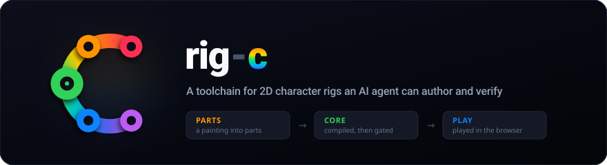

  

  

<em>One painting, rigged with <code>@rig-c/parts</code>, compiled and rendered by <code>rig-c</code>. <a href="https://github.com/rig-c/trailer">How it was made →</a></em>

**2D character rigs, authored by an AI agent that cannot see them, and verified before anything is written.**
One painting goes in; a rigged, animated character that plays in the browser comes out. Every stage refuses by name what it cannot verify, so a wrong file never reaches the disk.

rig-c makes no images: the painting and its layer split come from image models you run yourself.

<a href="https://github.com/rig-c/getting-started"><b>→ Getting started</b></a>

### Repositories

`create` sets up the project with the user's direction, an interview and a signed plan. `parts` makes the pieces, `core` compiles and checks the rig, and `play` or `adapters` run it. `pose` adds motion, and `review` is where a person looks at the result.

| Repository | Package | What it does |
| --- | --- | --- |
| [**create**](https://github.com/rig-c/create) | `@rig-c/create` | Project direction, an interview and a signed plan before rigging |
| [**parts**](https://github.com/rig-c/parts) | `@rig-c/parts` | Turns one painting's layers into rig-ready parts, meshes, bones, physics and an idle |
| [**core**](https://github.com/rig-c/core) | `rig-c` | Compiles a rig and motion spec into skeleton data, checked before a byte is written |
| [**play**](https://github.com/rig-c/play) | `@rig-c/play` | Plays the compiled model in the browser, as DOM elements or one canvas |
| [**adapters**](https://github.com/rig-c/adapters) | `@rig-c/pixi` · `@rig-c/phaser` · `@rig-c/three` | Plays a model inside PixiJS, Phaser or Three.js, with no Spine runtime |
| [**pose**](https://github.com/rig-c/pose) | `@rig-c/pose` | Puts motion from a video, a dataset or hand-placed points onto a rig |
| [**review**](https://github.com/rig-c/review) | `@rig-c/review` | A local workspace to inspect a rig and export feedback bound to a frame, bone or slot |

| Also here | |
| --- | --- |
| [**getting-started**](https://github.com/rig-c/getting-started) | The guide for people setting the toolchain up |
| [**examples**](https://github.com/rig-c/examples) | The public example corpus |
| [**exam**](https://github.com/rig-c/exam) | The open-book exam for AI agents |
| [**trailer**](https://github.com/rig-c/trailer) | The trailer, with one command to rebuild it |

### Does your model pass?

[**rig-c/exam**](https://github.com/rig-c/exam) gives an agent one painting and the installed packages, and nothing else.

<!-- exam-summary:start — generated by rig-c/exam; do not edit by hand -->
**Basic:** 14 of 17 models passed every graded line, from each vendor's lighter tier to its heaviest. **Advanced:** 5 of 6 passed every graded row in all three rounds.
<!-- exam-summary:end -->

Claude Sonnet and Gemini Flash are already enough for this work; Claude Haiku and GPT Luna miss some lines. [See every result](https://github.com/rig-c/exam#results), or [sit it with yours](https://github.com/rig-c/exam/blob/main/PROMPT.md).

---

The tools are MIT licensed; the exam's content is CC BY-NC 4.0. `rig-c` is also published as `@rig-c/core`, and names such as `rig-create`, `rig-parts` and `spine-rigc` are aliases of the same packages.
